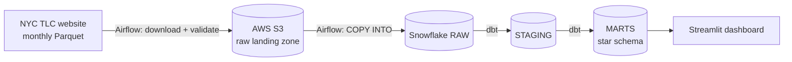

# NYC Taxi ELT Data Platform

An end-to-end ELT pipeline that loads 12 months of NYC taxi trips ([X]M rows) from the
NYC TLC into Snowflake on a monthly schedule, models them into a tested star schema with
dbt, and serves a dashboard.

> **Status:** ingestion complete (scheduled, idempotent, reconciled). dbt modeling in progress.

## Why this project

NYC's Taxi & Limousine Commission publishes every yellow and green taxi trip as monthly
Parquet files. This project turns those raw files into a reliable, tested data model that
answers:

1. Which pickup zones and hours generate the most revenue?
2. How much does the congestion relief zone fee add per trip, and where is it paid most?
3. What share of trips are airport trips, and what do they earn?
4. How do tip rates vary by payment type, borough and time of day?
5. Where do yellow and green taxis compete in the same zones?

## Architecture



- **Extract and load** are orchestrated by Airflow; **transform** happens inside Snowflake with dbt.
- Raw files are kept untouched in S3, so any month can be replayed from source.

## Tech stack

| Layer | Tool | Why |
|---|---|---|
| Orchestration | Apache Airflow 3 (Astro CLI, Docker) | Scheduling, retries and dependency management; one-command local setup |
| Ingestion | Python (requests, pyarrow, boto3) | Download with retries, schema and row-count validation, upload with size check |
| Data lake | AWS S3 | Cheap, durable landing zone that Snowflake reads directly |
| Warehouse | Snowflake | Separate storage and compute; X-Small warehouse with 60s auto-suspend |
| Transformation | dbt Core | Version-controlled SQL models, tests, docs and lineage *(TODO: Day 5–7)* |
| Serving | Streamlit | Dashboard on the marts layer *(TODO: Day 9)* |
| Testing / CI | pytest, GitHub Actions | Unit tests for ingestion; CI on every pull request *(TODO: Day 8)* |

## Data

- **Source:** [NYC TLC Trip Record Data](https://www.nyc.gov/site/tlc/about/tlc-trip-record-data.page): yellow and green taxi trips
- **Window:** September 2025 – August 2026 (12 months, all after congestion pricing began, so columns are consistent)
- **Volume:** [X]M yellow + [Y]K green trips = **[total] rows**
- **Reference data:** taxi zone lookup (~265 zones) as a dbt seed

## How the pipeline works

The `nyc_taxi_monthly` DAG runs at 06:00 UTC on the 1st of each month and loads the month
that just ended.

```
target_month ─┬─ wait_yellow → ingest_yellow → load_yellow → check_yellow
              └─ wait_green  → ingest_green  → load_green  → check_green
```

1. **Wait:** a sensor checks twice a day until TLC publishes the file (TLC publishes ~2 months late).
2. **Ingest:** download with retries and exponential backoff, validate the schema and row count, upload to S3, verify the uploaded size.
3. **Load:** delete any rows from that source file, then `COPY INTO` the RAW table, so **reruns never create duplicates**.
4. **Check:** reconcile the Snowflake row count against the file's row count; the task fails on any mismatch.

Every raw row carries `_source_file` and `_loaded_at` audit columns, so any number can be
traced back to its file and load time.

## Data quality

*TODO (Day 6–7): rules applied, number of dbt tests, how bad rows are quarantined with a reason code.*

## Data model

*TODO (Day 7): star schema diagram, fact table grain, dimensions, link to dbt docs.*

## Results

| Metric | Value |
|---|---|
| Rows loaded (12 months, yellow + green) | [total] |
| Ingest time per month (yellow) | [~N min] |
| Load time per month (COPY INTO) | [~N sec] |
| Full 12-month backfill | [~N min] |
| Reruns | Same row counts before and after (idempotent) |
| dbt tests passing | *TODO* |
| Cost | [under $X] |

## Run it yourself

*Requires Docker Desktop, the Astro CLI, an AWS account and a Snowflake account.*

```bash
git clone https://github.com/[your-username]/nyc-taxi-elt.git && cd nyc-taxi-elt
cp .env.example .env              # fill in AWS and Snowflake settings
# run snowflake/setup.sql and snowflake/raw_tables.sql in Snowflake
astro dev start                   # Airflow UI at http://localhost:8080
```

## Design decisions and trade-offs

- **ELT, not ETL:** raw data lands untouched; all cleaning happens in version-controlled SQL in the warehouse.
- **S3 in front of Snowflake:** keeps raw files independent of the warehouse, so any month can be replayed or another engine can read them.
- **No AWS keys in Snowflake:** Snowflake reads S3 through a storage integration that assumes a read-only IAM role with an external ID.
- **Least-privilege identities:** separate human and machine identities in AWS and Snowflake; the pipeline user can only touch one bucket.
- **Key-pair auth for Airflow → Snowflake:** a dedicated service user signs in with a key pair (JWT); no passwords, no MFA prompts.
- **Idempotent loads:** delete-then-insert by source file, plus `max_active_runs` to avoid concurrent writes.
- **Sensor for late data:** the DAG waits for publication in reschedule mode instead of failing or holding a worker.
- **Same region for S3 and Snowflake (us-east-2):** avoids cross-region transfer cost.
- **Shortcut taken:** locally, Airflow uses an IAM user's access keys; in production I'd attach an IAM role to the Airflow workers so no long-lived keys exist.

See [docs/decisions.md](docs/decisions.md) for the full log.

## Repo structure

```
dags/                 Airflow DAG (nyc_taxi_monthly)
include/ingestion/    Python ingestion module (download, validate, upload)
tests/ingestion/      pytest tests for the ingestion module
snowflake/            Setup and raw table SQL
dbt/                  dbt project (TODO)
dashboard/            Streamlit app (TODO)
docs/                 Decisions, data quality rules, diagrams
```